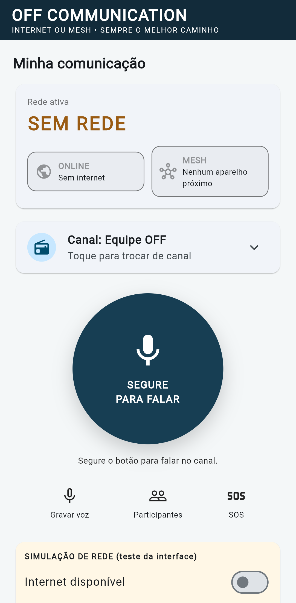

# OFF Communication

Comunicação push-to-talk (PTT) e mensagens de voz para Android e iOS com
**rede híbrida**:

> **OFF Communication = internet quando disponível + rede Mesh quando
> necessário + armazenamento e sincronização inteligente.**

| Situação | Caminho | Status |
|---|---|---|
| Com internet (Wi-Fi ou dados) | **ONLINE**: WebRTC + SFU, alcance sem limite geográfico | Fase C — não implementado |
| Sem internet, com celulares próximos | **MESH**: rede local entre aparelhos, com retransmissão (multi-hop) | Fase B — transporte UDP experimental |
| Sem nenhum caminho | **Store-and-forward**: mensagem gravada fica na fila | Fase B — contratos definidos |
| Internet volta | **Sincronização** idempotente das pendências | Fase D |

O usuário não troca de modo: o `ConnectivityCoordinator` escolhe a rota
(ver `docs/DECISIONS.md`, ADR-005).

## Estado atual: Fase A concluída



O que **funciona** hoje:

- App Flutter com tela inicial "Minha comunicação", status **ONLINE / MESH /
  SEM REDE**, lista de canais de demonstração e botão PTT que reage no toque.
- Decisão de rota real (lógica pura e testada): internet → ONLINE; sem
  internet com peers → MESH; sem nada → voz ao vivo indisponível e mensagem
  gravada vai para a fila.
- Envelope de protocolo versionado (`MeshPacket`) com validação: expiração,
  tamanho, hop limit, versão, destino obrigatório.
- Transporte UDP (`UdpLanTransport`) que envia/recebe `MeshPacket`, testado
  em loopback; ainda **não** ligado à interface.
- Permissões nativas Android/iOS de rede local e microfone.

O que **não existe ainda** (não está simulado como se funcionasse):

- Estado de rede real: a Fase A usa um **painel de simulação** na tela.
- Captura/reprodução de áudio, codec Opus, WebRTC.
- Descoberta de peers, retransmissão Mesh, fila persistida, criptografia.

Relatório detalhado: [`docs/FASE_A_RELATORIO.md`](docs/FASE_A_RELATORIO.md).

## Requisitos

- Flutter stable (testado com 3.47.9 / Dart 3.13.7)
- Android Studio (Android) e Xcode em macOS (iOS)
- Aparelhos físicos para testes de rede e microfone

## Rodar

```bash
cd off_communication
flutter pub get
flutter analyze
flutter test
flutter run            # com um aparelho/emulador conectado
```

As pastas `android/` e `ios/` já estão geradas e com as permissões de
`docs/PLATFORM_SETUP.md`.

## Meta de validação de engenharia

> Dois Androids e dois iPhones conversando com a internet desligada, e um
> terceiro aparelho retransmitindo a comunicação.

Plano de teste e cuidados (inclusive por que "retransmitir" num único
roteador não prova o multi-hop) em `docs/TECHNICAL_ARCHITECTURE.md` §13.

## Roteiro

A. Base executável ✅ · B. LAN offline + Mesh + fila · C. Online (WebRTC/SFU)
· D. Transição híbrida e sincronização · E. Testes reais e hardening.

## Limites honestos

- Não há alcance garantido em metros/quilômetros: depende de rádio, antena,
  obstáculos, densidade de aparelhos e modelo do celular.
- Android e iOS não garantem retransmissão contínua em segundo plano. A
  primeira versão do Mesh funciona **com o app aberto**; segundo plano será
  testado separadamente em cada sistema.
- O protocolo atual **não é seguro** (sem autenticação nem criptografia). Não
  usar com dados sensíveis ou em emergências reais.
