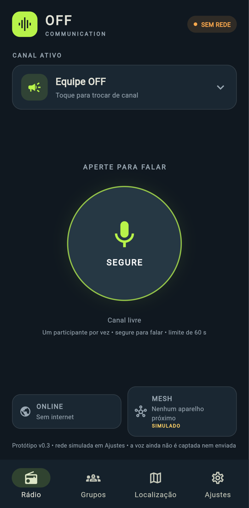

# OFF Communication

Comunicação push-to-talk (PTT) e mensagens de voz para Android e iOS com
**rede híbrida**:

> **OFF Communication = internet quando disponível + rede Mesh quando
> necessário + armazenamento e sincronização inteligente.**

| Situação | Caminho | Status |
|---|---|---|
| Com internet (Wi-Fi ou dados) | **ONLINE**: WebRTC + SFU, alcance sem limite geográfico | Fase C — não implementado |
| Sem internet, com celulares próximos | **MESH**: rede local entre aparelhos, com retransmissão (multi-hop) | Fase B — transporte UDP experimental |
| Sem nenhum caminho | **Store-and-forward**: mensagem gravada fica na fila | Fase B — contratos definidos |
| Internet volta | **Sincronização** idempotente das pendências | Fase D |

O usuário não troca de modo: o `ConnectivityCoordinator` escolhe a rota
(ver `docs/DECISIONS.md`, ADR-005).

## Estado atual: v0.3



Visual e abas da v0.2 (Rádio, Grupos, Localização, Ajustes) sobre a
arquitetura da Fase A. Detalhes em
[`docs/V03_RELATORIO.md`](docs/V03_RELATORIO.md) e
[`docs/FASE_A_RELATORIO.md`](docs/FASE_A_RELATORIO.md).

O que **funciona** hoje:

- **PTT hold-to-talk com um transmissor por vez**
  ([`docs/FLOOR_CONTROL.md`](docs/FLOOR_CONTROL.md)):
  - estados SEGURE, FALANDO, OUVINDO, OCUPADO e SEM ROTA;
  - limite de 60 s;
  - som e vibração no início e no fim.
- **Escolha automática de rota:**
  - internet → ONLINE;
  - sem internet e com peers → MESH;
  - sem nada → voz ao vivo indisponível.

  Se a rota passa de ONLINE para MESH durante a fala, a fala continua.
- **Envelope de protocolo** (`MeshPacket`) validado e transporte UDP testado
  em loopback.
- **Localização** desligada por padrão, com consentimento explícito.
- **Laboratório de teste** em Ajustes para simular internet, aparelhos
  próximos e outra pessoa falando.

O que **não existe ainda** (não está simulado como se funcionasse):

- Rede real: o estado de rede vem do laboratório de teste.
- Captura e envio de voz, Opus, WebRTC.
- Coordenação da palavra entre aparelhos diferentes: o árbitro ainda é local.
- Descoberta de peers, malha, fila persistida, criptografia, mapa.

Simulador da malha com 5 aparelhos: `tools/off_lab.html`.

## Requisitos

- Flutter stable (testado com 3.47.9 / Dart 3.13.7)
- Android Studio (Android) e Xcode em macOS (iOS)
- Aparelhos físicos para testes de rede e microfone

## Rodar

```bash
cd off_communication
flutter pub get
flutter analyze
flutter test
flutter run            # com um aparelho/emulador conectado
```

As pastas `android/` e `ios/` já estão geradas e com as permissões de
`docs/PLATFORM_SETUP.md`.

## Meta de validação de engenharia

> Dois Androids e dois iPhones conversando com a internet desligada, e um
> terceiro aparelho retransmitindo a comunicação.

Plano de teste e cuidados (inclusive por que "retransmitir" num único
roteador não prova o multi-hop) em `docs/TECHNICAL_ARCHITECTURE.md` §13.

## Roteiro

A. Base executável ✅ · B. LAN offline + Mesh + fila · C. Online (WebRTC/SFU)
· D. Transição híbrida e sincronização · E. Testes reais e hardening.

## Limites honestos

- Não há alcance garantido em metros/quilômetros: depende de rádio, antena,
  obstáculos, densidade de aparelhos e modelo do celular.
- Android e iOS não garantem retransmissão contínua em segundo plano. A
  primeira versão do Mesh funciona **com o app aberto**; segundo plano será
  testado separadamente em cada sistema.
- O protocolo atual **não é seguro** (sem autenticação nem criptografia). Não
  usar com dados sensíveis ou em emergências reais.
