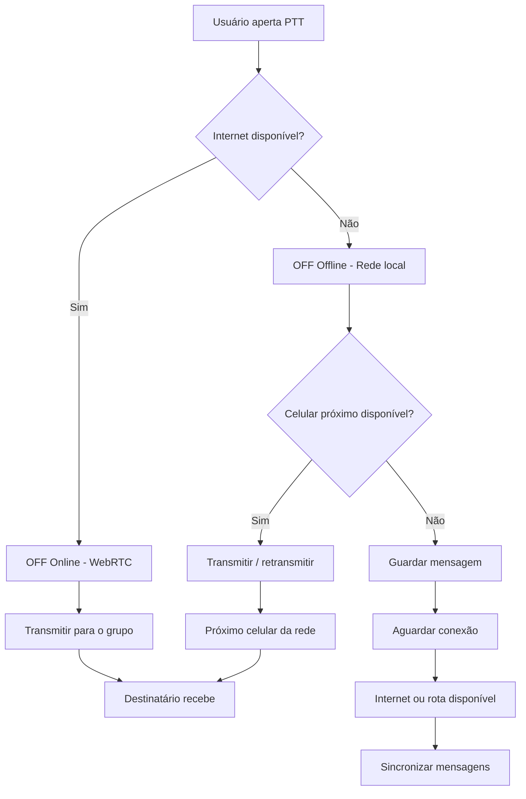

# OFF Communication — Documento Técnico

## 1. Produto

Aplicativo multiplataforma de comunicação push-to-talk (PTT) e mensagens de voz, com prioridade para operação sem internet. Público: uso pessoal/viagens, empresas/indústria, eventos e operações de apoio.

## 2. Requisitos funcionais do MVP

- Criar identidade local do dispositivo.
- Exibir canais locais preconfigurados.
- Descobrir outros dispositivos na mesma LAN.
- PTT half-duplex: um transmissor por canal no MVP.
- Enviar áudio ao vivo em frames curtos, com baixa latência.
- Gravar e enfileirar mensagens de voz para entrega posterior.
- Mostrar participantes e estado de conectividade.
- Modo SOS com fila local e envio oportunista.
- Funcionar sem conta ou serviço cloud para o teste LAN.

## 3. Requisitos não funcionais

- Android e iOS.
- Operação LAN sem WAN/internet.
- Baixa latência de voz; meta inicial de laboratório: < 500 ms em LAN estável.
- Tolerância a perda de pacotes e jitter.
- Armazenamento local com limite e política de expiração.
- Criptografia ponta a ponta antes de piloto externo.
- Observabilidade local sem registrar conteúdo de áudio.
- Consumo de bateria controlado.

## 4. Modos de conectividade — rede híbrida (ADR-005)

O app usa automaticamente o melhor caminho; o usuário não troca de modo.

Observação: "Guardar mensagem" vale para **mensagens gravadas**. Voz ao vivo
sem rota não é guardada (ADR-004); a interface avisa e oferece gravar.

### 4.0 OFF Online

Wi-Fi com internet ou dados móveis. Voz ao vivo por WebRTC com SFU;
sinalização separada da mídia; Supabase só para cadastro, grupos,
autenticação e sincronização de metadados (nunca áudio em tempo real).
Criptografia ponta a ponta planejada desde o início.

### 4.1 OFF Offline / Local — primeira entrega do modo offline

Todos os aparelhos conectam-se ao mesmo access point/roteador portátil, que pode estar sem WAN. O app usa descoberta por broadcast/multicast ou descoberta assistida pelo gateway e troca datagramas UDP na LAN. Esta é a opção mais previsível para Android+iOS no MVP.

### 4.2 OFF Direct — fase posterior

Adaptadores nativos separados: Android (Wi-Fi Direct / Nearby Connections, sujeito a testes de compatibilidade) e iOS (Multipeer Connectivity / Network framework, conforme cenário). Não presumir interoperabilidade direta entre os dois sistemas. Manter interface `PeerTransport` comum.

### 4.3 OFF Gateway — longo alcance

Gateway conecta a LAN local a um enlace de rádio ou rede mesh apropriada. Voz pode atravessar gateways apenas após definir codec, capacidade de canal, duplex, latência, criptografia, espectro e homologação. LoRa fica limitado a telemetria/SOS e mensagens pequenas, não áudio ao vivo.

## 5. Áudio

Pipeline pretendido:

Microfone → captura PCM → Opus (mono, 16 ou 24 kHz, frames de 20 ms) → criptografia autenticada → datagramas UDP → jitter buffer → descriptografia → Opus decode → saída de áudio.

Requisitos: controle de ganho, cancelamento de eco quando aplicável, foco de áudio, interrupções telefônicas, rota Bluetooth/headset, tratamento de permissão e interrupções de app. Implementar PTT half-duplex e arbitragem de fala no primeiro release.

## 6. Protocolo de rede

Envelope versionado com: versão, tipo, ID de dispositivo pseudônimo, ID de canal, sequência, timestamp monotônico, ID de sessão, nonce, payload e tag de autenticação. Não transmitir nome, telefone ou localização em broadcast aberto.

Tipos: HELLO, HEARTBEAT, JOIN, LEAVE, FLOOR_REQUEST, FLOOR_GRANTED, AUDIO_FRAME, VOICE_MESSAGE, ACK, SOS, ROUTE_ADVERTISEMENT.

Áudio ao vivo: UDP com sequência e timestamp, tolerando perda limitada; mensagens gravadas: transferência fragmentada com ACK, checksum, retomada e expiração.

## 7. Segurança

O starter atual é demonstração de transporte e não contém segurança. Antes de testes com dados reais:

- Identidade por dispositivo e pareamento por QR/código curto.
- Criptografia autenticada ponta a ponta (ex.: libsodium XChaCha20-Poly1305 ou AES-GCM via biblioteca auditada).
- Derivação e rotação de chaves por canal.
- Nonce único, sequência e proteção contra replay.
- Autorização para entrar em canais privados.
- Apagamento seguro de chaves e opção de revogar dispositivo.
- Não usar criptografia caseira.

## 8. Arquitetura de software

Flutter UI + serviços Dart + adaptadores nativos Kotlin/Swift. Separar domínio de transporte para trocar LAN, direct e gateway sem reescrever PTT.

Interfaces previstas: `PeerTransport`, `AudioCapture`, `AudioCodec`, `AudioOutput`, `IdentityStore`, `MessageRepository`, `ChannelRepository`.

## 9. Cloud opcional

Supabase é apenas plano de controle: cadastro, organização, convites, configuração e sincronização quando houver internet. Nunca será dependência do caminho de áudio offline. Sem internet, o app mantém identidade local e mensagens na fila.

## 10. Critérios de aceite do MVP

1. Dois aparelhos (um Android e um iPhone) no mesmo AP sem WAN descobrem-se.
2. Um usuário mantém PTT pressionado e o outro ouve voz inteligível em tempo real.
3. O canal impede dois transmissores simultâneos ou arbitra a vez.
4. Mensagem de voz gravada é armazenada localmente e entregue após reconexão.
5. Permissões negadas são tratadas com orientação clara.
6. Encerrar/reabrir app não corrompe mensagens locais.
7. Testes de 30 minutos sem crash e com métricas de perda/latência.

## 11. Fora do MVP

- Garantia de 10 km usando somente celulares.
- Repetição automática em segundo plano no iOS.
- Rádio proprietário.
- Comunicação de missão crítica ou substituição de sistemas profissionais/emergenciais.
- Rastreamento contínuo de localização.

## 12. Roteiro

A. LAN discovery e testes de rede. B. Áudio Opus em tempo real. C. segurança e pareamento. D. mensagens store-and-forward. E. adaptadores direct. F. gateway e testes RF/homologação.

## 13. Meta de validação: 2 Androids + 2 iPhones, internet desligada, 1 repetidor

Objetivo: quatro aparelhos (2 Android, 2 iPhone) conversam sem internet, e
um terceiro aparelho comprovadamente **retransmite** a comunicação entre dois
que não se alcançam diretamente.

### 13.1 Cuidado com o teste de retransmissão

Com todos os aparelhos no mesmo roteador/hotspot, todos se alcançam
diretamente: um "repetidor" nessa topologia não prova nada. Para validar o
multi-hop de forma honesta há duas opções:

1. **Topologia forçada em LAN (Fase B, primeiro):** modo de teste em que o
   aparelho A só aceita pacotes do vizinho B, e C só de B (lista de vizinhos
   permitidos por aparelho). O tráfego A→C precisa passar por B, e o
   `hopCount` recebido em C deve ser 1. Prova o algoritmo da malha
   (TTL, deduplicação, não devolver ao remetente) em aparelhos reais.
2. **Alcance físico real (depois):** dois segmentos de rede/rádio distintos
   ligados por um aparelho que participa dos dois (ex.: hotspot do repetidor
   + Wi-Fi de outro AP, ou enlaces diretos). Exige os adaptadores diretos.

### 13.2 Restrição Android ↔ iPhone sem roteador

Wi-Fi Direct (Android) e Multipeer Connectivity (iOS) não interoperam. Um
enlace direto Android↔iPhone sem roteador precisa de uma tecnologia comum aos
dois sistemas — Bluetooth Low Energy é a candidata conhecida, com banda baixa
(adequada a texto, controle e talvez voz muito comprimida, a medir). Outras
opções (ex.: Wi-Fi Aware nas versões recentes de iOS/Android) precisam ser
verificadas em documentação oficial e em aparelhos antes de entrar no
roteiro. Até lá, o teste com internet desligada usa um roteador/hotspot sem
WAN como meio comum.

### 13.3 Roteiro do teste

| # | Cenário | Critério de aprovação |
|---|---|---|
| 1 | 4 aparelhos no mesmo AP sem WAN | Todos aparecem em Participantes em < 10 s |
| 2 | Texto em canal | Entregue aos 3 demais, sem duplicata |
| 3 | PTT ao vivo Android → iPhone e iPhone → Android | Voz inteligível, latência medida |
| 4 | Topologia forçada A–B–C | Mensagem de A chega a C com `hopCount = 1`, uma única vez |
| 5 | Desligar B no meio | Mensagem gravada fica pendente em A e é entregue quando B volta |
| 6 | 30 min contínuos, app em primeiro plano | Sem crash; perda e latência registradas |

Registrar modelo, versão do sistema, latência, perda de pacotes e bateria.
