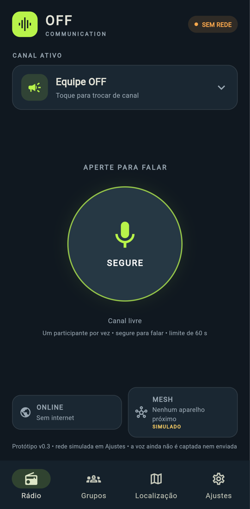
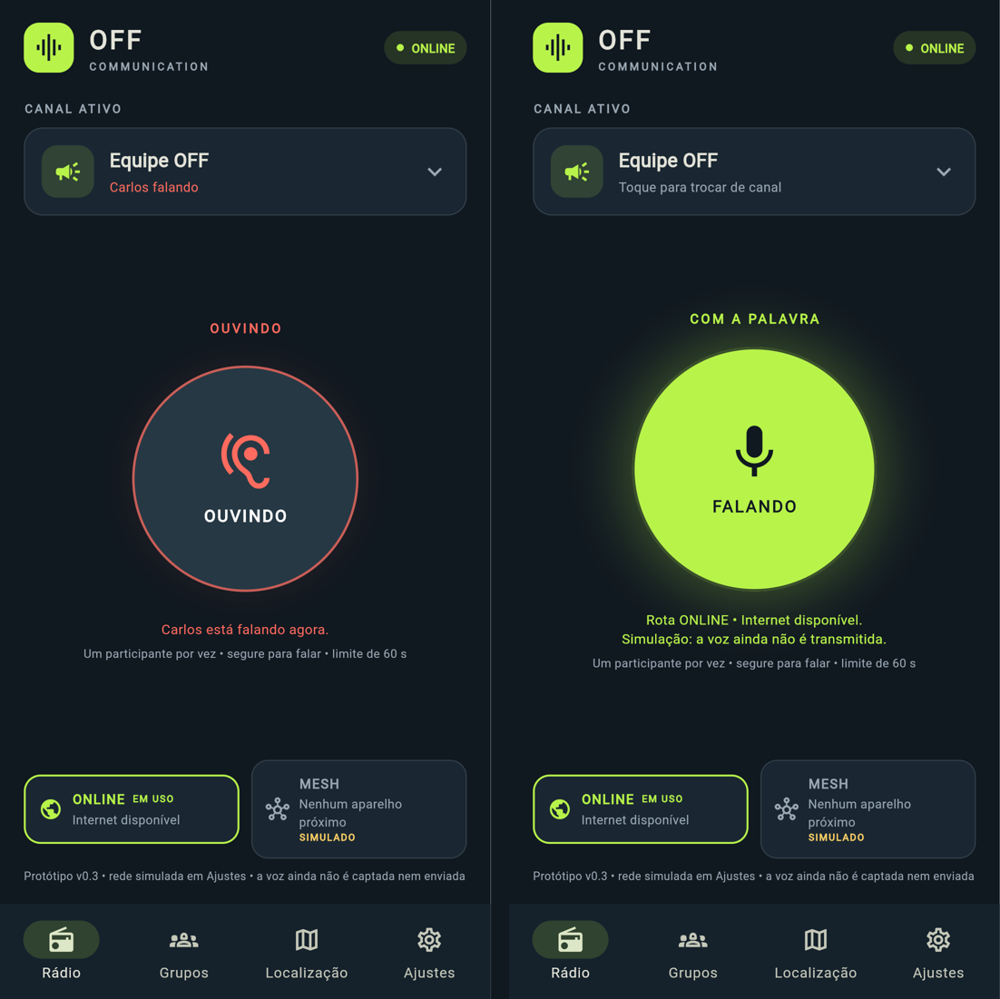

# Relatório — v0.3 (v0.2 incorporada à arquitetura da Fase A)

Data: 2026-11-08 · Flutter 3.47.9 / Dart 3.13.7




## O que veio da v0.2 e foi mantido

- Identidade visual escura com verde-limão.
- Abas Rádio, Grupos, Localização e Ajustes.
- PTT hold-to-talk com som e vibração no início e no fim.
- Regra de um transmissor por vez e o documento de floor control.

## O que foi corrigido em relação à v0.2

| v0.2 | v0.3 |
|---|---|
| Tudo em `main.dart` (260 linhas) | Telas, controlador, árbitro e rede separados; widgets não decidem regra |
| "Canal ocupado" era um booleano do próprio aparelho: o usuário só bloqueava a si mesmo | `FloorArbiter` com concessão, negação, token e limite de 60 s, testado |
| Chave manual ONLINE/OFFLINE na tela Rádio | Modo automático (`ConnectivityCoordinator`). A simulação fica num "Laboratório de teste" em Ajustes, marcada como simulação |
| `_tone(starting:)` ignorava `starting`: início e fim iguais | Início: impacto forte + clique. Fim: impacto leve + clique. Negado: vibração |
| `GestureDetector.onTapDown` (pode atrasar e cancela ao arrastar) | `Listener`: ponteiro baixo/cima/cancelado |
| Localização compartilhada **ligada** por padrão | Desligada por padrão, liga só com confirmação explícita |
| Texto do mapa com `\\n` aparecendo literalmente | Corrigido |
| Grupos e contatos fictícios sem aviso | Rótulo de demonstração |
| Tela Rádio estourava em celular pequeno (Column fixa) | Rolável, testada em 360×640 |
| `withOpacity` obsoleto, `flutter_lints` 4 | `withValues`, `flutter_lints` 5 |

## Novo nesta versão

- Estados do PTT: SEGURE, AGUARDE, FALANDO, OUVINDO (outra pessoa com a
  palavra), OCUPADO (negado) e SEM ROTA.
- A fala termina sozinha, liberando o canal, quando:
  - estoura o limite de 60 s;
  - toda rede cai;
  - o usuário troca de canal ou de aba;
  - o app vai para segundo plano.
- Se a rota passa de ONLINE para MESH durante a fala, a fala continua.
- Desempate de colisão na malha (`resolveFloorCollision`), determinístico.
- "Carlos falando" no laboratório usa o mesmo árbitro, então o fluxo de
  canal ocupado testado é o real.
- O cartão de rede marca qual caminho está EM USO.

## Comandos e resultados

```text
flutter analyze  → No issues found!
flutter test     → 41 testes, All tests passed!
```

Testes:

| Grupo | Testes |
|---|---|
| Árbitro + colisão | 10 |
| Controlador PTT | 8 |
| Telas | 8, inclusive celular pequeno |
| Protocolo, coordenador e transporte UDP (Fase A) | 15 |

Os testes de tela pegaram dois bugs antes da entrega:

1. Efeito de toque invisível nas chaves do laboratório.
2. "ONLINE EM USO" estourando a largura em celular de 6,5".

## Não verificado

- Build Android/iOS e aparelho físico (sem Android SDK/Xcode neste ambiente).
- Som do clique no iOS.
- Coordenação entre aparelhos diferentes: o árbitro ainda é local.

## Próximo passo

Continua a Fase B (descoberta, texto, malha, fila). O `FLOOR_CLAIM` da malha
(ver FLOOR_CONTROL.md) entra junto com a descoberta, porque precisa dela.
